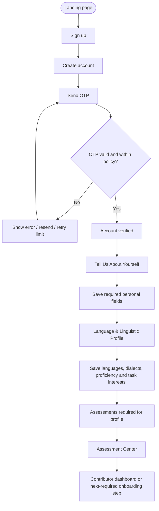
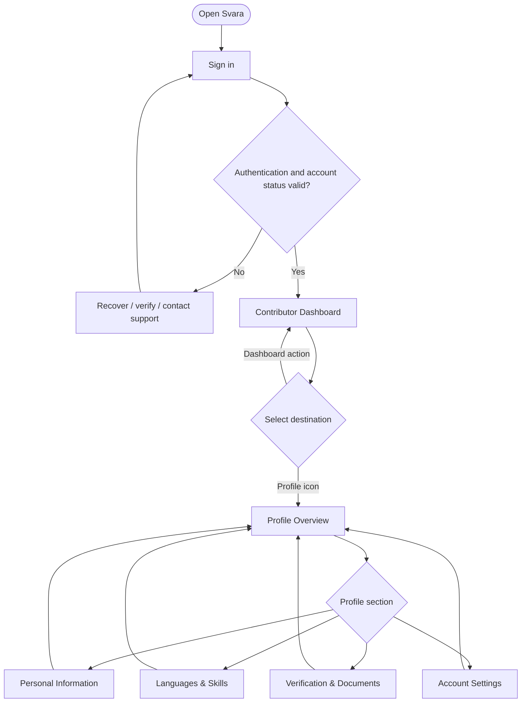
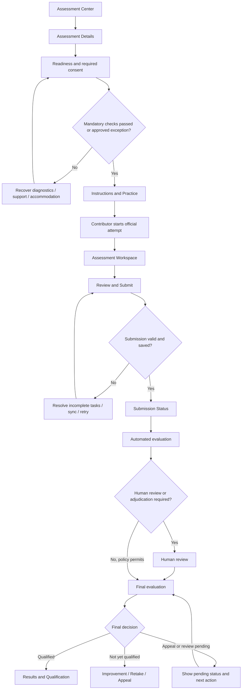
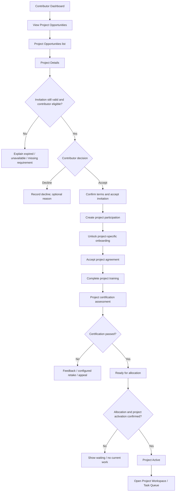
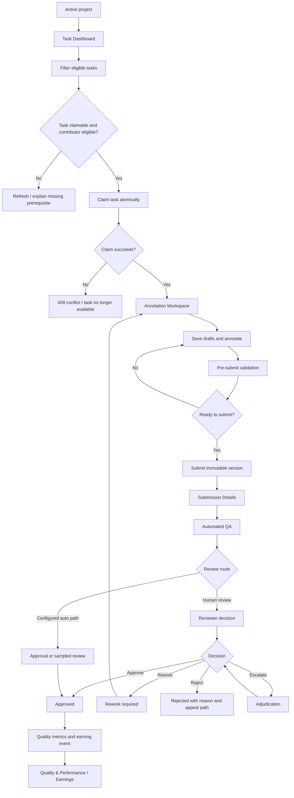
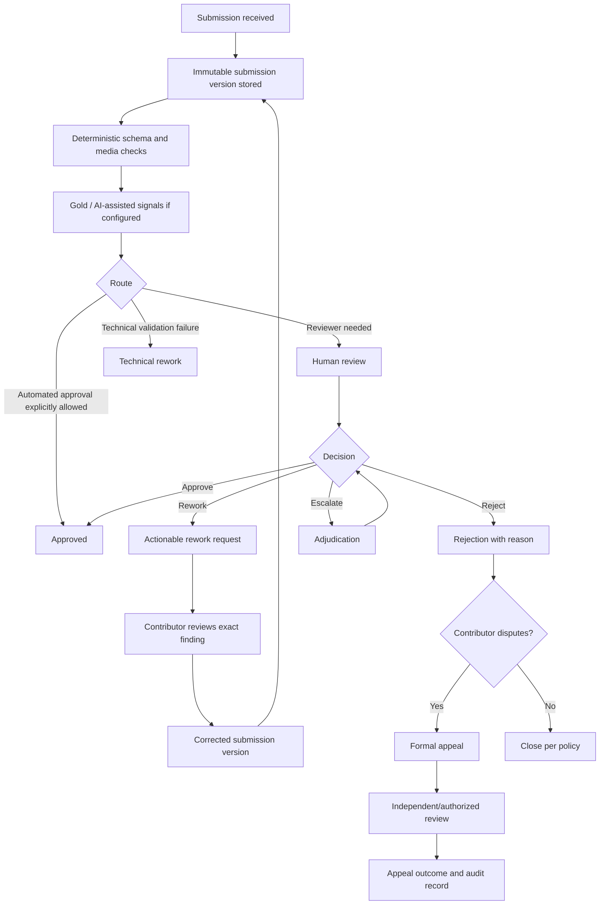
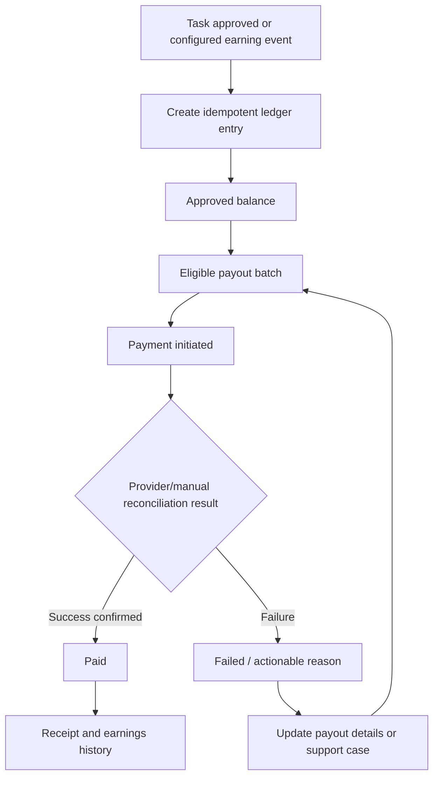
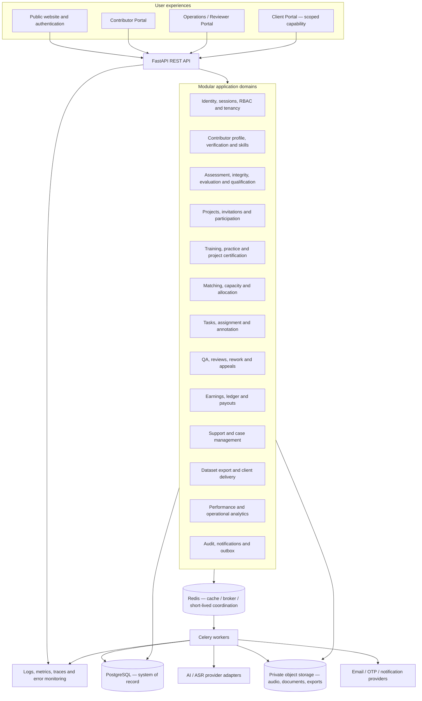

# Svara — High-Level Design (HLD)

**Document version:** 2.1  
**Date:** 7 November 2026  
**Product:** Svara — Human-in-the-Loop AI Data Operations Platform  
**Primary product focus:** Contributor lifecycle, speech and text annotation, project operations, quality and payments  
**Initial planning scale:** Approximately 100 contributors (planning assumption carried forward from HLD v1.0; validate before capacity commitments)  
**Initial data verticals:** Speech and text annotation  
**Companion documents:** `Svara_LLD.md`, `Svara_Product_Decision_Log.md`

---

## 0. Document intent and reading guide

This HLD consolidates the product flows and screen decisions defined during the Svara design discussions. It is intentionally both a product architecture document and a technical architecture document.

The HLD answers:

- What product capabilities does Svara provide?
- Which users and operational roles participate in each workflow?
- How does a contributor move from registration to paid production work?
- Which domains and system boundaries are required?
- How do assessment, project certification, annotation, quality, payment and support interact?
- Which design choices protect data quality, contributor trust, client isolation and operational efficiency?
- What should be built for the initial release, and what should remain a later capability?

The companion LLD defines implementation-level entities, relationships, APIs, state transitions, service responsibilities, async jobs and test cases.

### 0.1 Evidence and certainty labels

This document distinguishes three kinds of statements:

- **Confirmed product direction:** Explicitly described in the Svara workflow and screen discussions.
- **Recommended design:** A product or engineering recommendation made to make the described flow reliable and coherent.
- **Open decision:** A business, legal, operational or technical rule that must be confirmed before production. It must not be silently hardcoded.

The screen designs establish the user experience and intended capabilities; they do not prove that every backend integration, payment provider, security control, AI model or operational SLA already exists.

---

## 1. Product vision and operating model

Svara is a Human-in-the-Loop (HITL) AI Data Operations Platform. It connects organizations that need high-quality training or evaluation data with a managed contributor network, internal operations teams and specialist reviewers.

The platform recruits and qualifies contributors, matches them to projects, prepares them through project-specific training, collects speech and text annotations, evaluates submissions using deterministic checks and AI-assisted signals, routes work to human reviewers when required, records quality and earnings, and supports disputes and appeals.

The platform's value is not simply that it provides an annotation interface. Its value comes from operating a dependable data-production system:

1. **Capability discovery:** Understand what a contributor claims to know and what they have demonstrated through assessment.
2. **Controlled project entry:** Ensure contributors understand project requirements and accept terms before accessing restricted project training.
3. **Consistent execution:** Use project-specific, versioned schemas and guidelines in a reusable annotation workspace.
4. **Quality assurance:** Combine deterministic validation, benchmark/gold tasks, AI signals and human review without treating model output as ground truth.
5. **Traceability:** Preserve the origin, version, contributor, guideline, assessment, evaluation and review decision for each delivered annotation.
6. **Contributor trust:** Make decisions, rework, quality feedback, earnings and support status understandable and appealable.
7. **Client confidence:** Deliver approved, reproducible datasets with provenance and quality evidence.

### 1.1 Initial product scope

The current design work covers the contributor-facing lifecycle and the operational capabilities required to support it:

- Public landing page and contributor registration.
- Email/phone OTP verification according to configured account policy.
- Contributor onboarding: personal information and language/linguistic profile.
- Contributor profile management.
- Platform-level assessment and qualification.
- Project discovery, invitation acceptance and project onboarding.
- Project training and project-specific certification.
- Production task queue and task claiming.
- Speech and text annotation workspace.
- Submission review, QA, rework and quality feedback.
- Contributor quality and performance analytics.
- Earnings ledger and payout history.
- Support and formal appeal workflows.

### 1.2 Initial annotation verticals

**Speech and audio**

- Verbatim or project-configured speech transcription.
- Language and dialect identification.
- Hindi-English or other configured code-switching.
- Speaker labels and diarization.
- Segment and word timestamps where required.
- Punctuation, disfluency and unintelligible-speech conventions.
- Acoustic and non-speech event labels.

**Text**

- Text annotation and linguistic tagging.
- Named entity recognition (NER).
- Classification and sentiment labels.
- Span selection and label assignment.
- Project-specific structured annotation.

The exact annotation schema, language normalization and scoring policy are configured per project/version. The platform must not assume that one transcription convention or metric is valid for every language or customer.

### 1.3 Initial non-goals

Unless separately approved, the initial release does not require:

- Native iOS or Android applications.
- A public bidding marketplace where contributors negotiate project rates.
- Fully autonomous project allocation.
- Fully autonomous approval or rejection of every annotation.
- Automatic contributor suspension based solely on AI scores or isolated telemetry events.
- Real-time multi-user collaborative editing of the same annotation.
- Support for every possible modality or annotation type.
- Microservices from day one.
- Automated international payout rails in the first pilot.
- Universal continuous webcam proctoring for every assessment.

---

## 2. Product principles and non-negotiable distinctions

These principles should shape UI, backend models, workflow rules and operational policy.

### 2.1 Self-reported capability is not verified capability

A contributor can declare a language, dialect and proficiency level during onboarding. These are self-reported claims until supported by the configured verification or assessment process.

Store separately:

- Language relationship and proficiency claims.
- Dialect familiarity and exposure claims.
- Task preferences.
- Assessment attempts and results.
- Verified qualifications/certifications.
- Production performance evidence.

A native-language declaration does not automatically qualify a contributor for transcription, diarization, NER or any other task.

### 2.2 Platform qualification is not project certification

- **Platform assessment:** Measures a reusable, language/task-specific capability, such as Hindi speech transcription.
- **Project training:** Teaches project-specific instructions, annotation conventions, quality standards and tools.
- **Project certification:** Verifies that the contributor can apply the particular project's guidelines and schema.
- **Production quality:** Measures the contributor's real submitted work over a meaningful sample and period.

These are related but separate records and decisions.

### 2.3 Invitation accepted is not project activated

Accepting a project invitation creates a participation/onboarding relationship. It does not automatically provide production task access.

The expected progression is:

`INVITED → ACCEPTED → ONBOARDING_IN_PROGRESS → READY_FOR_ALLOCATION → ACTIVE`

Training and certification have their own statuses. Production access requires all configured prerequisites and an explicit activation/allocation decision.

### 2.4 Submission is not approval; approval is not payout

- A task submission is an immutable contributor response version.
- Automated QA produces findings and routing signals.
- Human review produces a review decision when required.
- Approved work becomes eligible for an earning event under the payment policy.
- A ledger entry is not the same thing as a completed bank transfer.

### 2.5 AI output is evidence, not ground truth

ASR comparison, LLM evaluation and anomaly detection can prioritize review, suggest corrections or produce quality signals. They must not silently overwrite human annotations or become the sole basis for high-impact adverse contributor decisions.

### 2.6 Separate answer status, review status and synchronization status

A task can be answered, flagged and successfully saved at the same time. These must not be collapsed into one status field.

### 2.7 Privacy and data minimization

Collect information only when there is a defined product, legal, safety, payment or project requirement. Education and professional experience may be optional context; they are not proxies for language proficiency. Religion and mandatory gender collection are not part of the defined contributor qualification model. Avoid collecting precise residential addresses when country/region/timezone is enough.

### 2.8 Contributor-facing transparency

Contributors should understand why an action is needed, what happens next and how to request help or appeal an eligible decision. Do not expose internal model prompts, hidden gold answers, internal reviewer notes, fraud scores, storage identifiers or confidential matching weights.

---

## 3. Users, roles and trust boundaries

The contributor portal is the current product-design focus. The platform still needs internal roles to operate quality, allocation, project and payment workflows, as well as client access to approved project outputs.

| Actor | Responsibilities | Access boundary |
|---|---|---|
| Contributor | Profile, assessments, invitations, training, tasks, submissions, feedback, earnings, support | Own profile, own assessments, accepted project scope, own assignments/submissions/earnings/cases |
| Reviewer | Inspect submissions, compare source and annotation, create findings, approve/rework/reject/escalate | Assigned or explicitly authorized project/review queue; no self-review |
| Senior reviewer / adjudicator | Resolve reviewer disagreement and escalations | Authorized escalated cases only |
| Project manager | Configure project, budget, requirements, guidelines, staffing, progress and delivery | Projects within assigned organization/project scope |
| Assessment manager | Configure assessment blueprints, item banks, rubrics, attempts and result review | Assessment-authoring/evaluation permissions; protected answer keys |
| Training owner | Maintain curriculum, lessons, practice and guideline mapping | Assigned project/training scope |
| Quality manager | Configure quality policy, calibration, sampling, audits and quality reporting | Authorized quality domain; limited PII by default |
| Payment/finance operator | Reconcile ledger and payout records | Financial permissions, masked sensitive payout data |
| Client member | View assigned project progress, agreed reports and approved delivery | Own organization's permitted projects and approved outputs |
| Client administrator | Manage client organization members and permissions | Own organization only |
| Platform administrator | Global configuration, access governance and platform audit | Explicit platform-level privileges; all actions audited |

A user may hold multiple roles. Roles must be combined with organization membership, project scope, resource ownership and action permissions. Frontend route hiding is not authorization.

---

## 4. Screen inventory and product capability map

Screen labels below follow the sequence described during product design. Some screens are separate routes; some may be state-driven pages or modal workflows. The inventory is a user-experience map, not a requirement to create one backend service per page.

### 4.1 Public, authentication and initial onboarding

| Step | Screen | Main responsibility |
|---|---|---|
| P01 | Landing page | Explain Svara, contribution types, trust signals, eligibility and primary contributor CTA |
| P02 | Sign-up | Create contributor account with required credentials and terms acknowledgement |
| P03 | OTP verification | Verify configured email/phone channel; resend, expiry, rate-limit and recovery states |
| P04 | Tell Us About Yourself | Collect essential personal/contact/location details; keep optional education/experience distinct |
| P05 | Language & Linguistic Profile | Add multiple languages, dialects, self-reported proficiency dimensions and per-language task interests |
| P06 | Initial assessment entry | Route contributor to the Assessment Center or required first assessment based on eligibility/configuration |

The OTP policy (email, phone or both) must be configurable and confirmed. Do not assume that successful OTP verification equals full identity/KYC verification.

### 4.2 Authenticated contributor dashboard and profile

| Screen | Main responsibility |
|---|---|
| Contributor Dashboard | Show contributor status, active tasks, invitations/opportunities, earnings snapshot, quality highlights and next actions |
| Profile Overview | Profile completeness, identity summary, language/qualification summary and links to profile sections |
| Personal Information | Legal/display name, contact endpoints, location and optional professional background |
| Languages & Skills | Multiple languages, dialects, speaking/listening/reading/writing proficiency, task preferences and verified qualifications |
| Verification & Documents | Email/phone/identity status, agreements, required document actions and verification appeals where applicable |
| Account Settings | Password, 2FA where supported, sessions, notification preferences, privacy/data export, deactivate/delete request |

Profile completion must be calculated from required fields only. Verification status and task qualification are independent of profile completion.

### 4.3 Platform assessment journey

| Sequence | Screen | Main responsibility |
|---|---|---|
| A1 | Assessment Center | Recommended, available, in-progress and completed assessments; no duplicate cards |
| A2 | Assessment Details | Capabilities tested, structure, duration, policy, attempts and qualification outcome |
| A3 | Readiness & Proctoring Check | Device, browser, audio, language input, connectivity, identity/proctoring prerequisites and consent |
| A4 | Instructions & Practice | Versioned guidelines, examples and unscored practice sandbox |
| A5 | Assessment Workspace | Timed practical/knowledge tasks, audio/text annotation, autosave, permitted integrity controls |
| A6 | Review & Submit | Answered/unanswered/flagged summary, save confirmation, final declaration and submission confirmation |
| A7 | Submission Status / Evaluation in Progress | Receipt, evaluation state and expected result window where supported |
| A8 | Results & Qualification | Final decision, competency breakdown, qualification credential and next steps |
| A9 | Improvement, Retake & Appeal | Targeted practice, retake eligibility/cooldown, appeal submission and status tracking |

Assessment requirements must be based on actual capabilities to be performed. A speech transcription assessment should prioritize unseen practical audio, with MCQ and reasoning items used as supporting evidence.

### 4.4 Project discovery and onboarding

| Screen | Main responsibility |
|---|---|
| Screen 14 — Project Opportunities | Discover, filter and compare invitations/recommendations; clear eligibility and compensation units |
| Screen 15 — Project Details & Contributor Onboarding | State-driven project hub for invitation review, acceptance, training, project certification, allocation and active status |
| Screen 16 — Project Training Modules | Curriculum navigation, guidelines, interactive examples, practice exercises, learning progress and support |
| Screen 17 — Project Certification Assessment | Project-specific assessment using shared assessment engine and project guideline version |

Project status is state-driven on Screen 15. Do not create a separate page for every state unless a workflow requires a distinct interaction.

**Invitation acceptance rule:** Contributors can preview public-safe project details, sample work and guideline summaries before acceptance. Mandatory restricted project-specific training unlocks after invitation acceptance and any required agreement acceptance. Acceptance does not guarantee allocation.

### 4.5 Production tasks, quality, finance and support

| Screen | Main responsibility |
|---|---|
| Screen 18 — Task Dashboard | Eligible/available/reserved/in-progress/submitted/review/rework/approved task queues, claim rules and workload capacity |
| Screen 19 — Annotation Workspace | Schema-driven speech/text editing, media controls, tagging, timestamps, autosave, validation and submit |
| Screen 20 — Submission Details | Submission status, automated checks, human review, findings, rework, dispute and earnings state |
| Screen 21 — Quality & Performance | Explainable metrics, sample counts, quality trends, competency profile and actionable refreshers |
| Screen 22 — Earnings & Payout History | Estimated/pending/approved/processing/paid ledger, payout history, compensation detail and payment support entry |
| Screen 23 — Support & Appeals | General support cases separate from formal assessment, quality, task or payment appeals |

---

## 5. End-to-end contributor journeys

### 5.1 First-time registration and onboarding

Business rules:

- OTP verification proves control of the configured contact channel; it does not prove language proficiency or identity unless a separate identity process is completed.
- Required onboarding fields should be minimal. Education and work experience are optional unless a specific project requires them.
- The contributor may add multiple languages and different task interests per language.
- Self-reported proficiency is stored separately from assessed/verified proficiency.
- Assessment Center recommendations are derived from language/task interests and qualification gaps.
- Returning users must resume from the next incomplete required step rather than restarting the entire form.

### 5.2 Returning contributor and profile management

Profile editing must have consistent save states: pristine, dirty, saving, saved and error. Sensitive changes (email, phone, payout destination, security settings) require backend validation and appropriate re-verification.

### 5.3 Platform assessment lifecycle

Assessment versions, question exposure, scoring policy and rubric versions must be snapshotted to each attempt. A user must not be scored against a rubric that changed after the attempt began.

### 5.4 Project opportunity, acceptance and onboarding

Rules:

- Screen 14 is a discovery and comparison page; the canonical acceptance action occurs on Screen 15 after reviewing requirements and terms.
- Acceptance is idempotent and must revalidate invitation expiry, eligibility and project capacity on the server.
- Training may have a public preview before acceptance; mandatory restricted training unlocks after acceptance.
- Training completion and project certification are separate.
- Project certification passing does not itself imply task assignment.
- `Open Project Workspace` is shown only after project activation/production access. Before activation, use actions such as `View Opportunities`, `Start Project Training`, `Continue Training`, `Start Certification` or `View Allocation Status`.

### 5.5 Production task lifecycle

A task flagged by a contributor is not automatically incorrect or rejected. Answer status, contributor flag, QA status, review status and sync status are separate concepts.

### 5.6 Submission, rework and dispute

### 5.7 Earnings and payout lifecycle

An estimate is not a ledger entry; an approved earning is not a bank transfer; a payout is not complete until reconciled. All financial state changes must be auditable.

### 5.8 Support and appeals

General support cases and formal appeals are separate case types. Support can be initiated from a task, submission, assessment, project or payout so the platform can attach relevant identifiers automatically. Appeals require eligibility checks, reason, affected record and review workflow. Hidden benchmark content and internal reviewer notes remain private.

---

## 6. System architecture

### 6.1 Architecture style

**Recommendation: modular monolith with separately deployed asynchronous workers.**

A modular monolith is appropriate for the current planning scale and product maturity. It reduces operational overhead while keeping domain boundaries explicit. Scale API instances and worker queues independently. Extract a module into a separate service only when measured load, ownership, isolation or release needs justify it.

### 6.2 Logical architecture

### 6.3 Proposed technology baseline

The following stack carries forward the v1.0 proposal. It is a recommended baseline, not a statement that all tools have already been selected or deployed.

| Layer | Proposed technology | Responsibility |
|---|---|---|
| Web | React, TypeScript, Tailwind CSS | Public, contributor, operations and client interfaces |
| API | FastAPI | Versioned REST endpoints and orchestration |
| Validation | Pydantic | API/configuration validation |
| ORM | SQLAlchemy 2.x | Relational persistence |
| Migrations | Alembic | Database evolution |
| Primary DB | PostgreSQL | Transactional source of truth and JSONB payloads |
| Cache/broker | Redis | Caching, broker and short-lived coordination |
| Background jobs | Celery workers | Media processing, AI evaluation, exports and notifications |
| Object storage | Private S3-compatible storage | Audio, evidence documents, training assets and exports |
| Media tooling | FFmpeg | Audio inspection/conversion and metadata extraction |
| ASR/AI | Provider adapters | ASR comparison and configured AI-assisted quality signals |
| Observability | OpenTelemetry and Sentry (or equivalent) | Traces, metrics and errors |

PostgreSQL stores metadata and structured records; it does not store large media binaries. Private object storage is the default for source assets, documents and exports. Signed URLs should be short-lived and scoped.

### 6.4 Domain module responsibilities

| Module | Main responsibility | Key outputs |
|---|---|---|
| Identity & Access | Registration, OTP, login, password, sessions, roles, tenancy | Authenticated principal and authorized scope |
| Contributor Profile | Personal info, languages, dialects, preferences, verification | Contributor capability profile and verification evidence |
| Assessment | Blueprints, item bank, attempts, responses, proctoring, scoring | Assessment decisions and evidence |
| Qualification | Platform and project-specific credentials | Scoped qualification records |
| Project | Client project, requirements, guideline versions, assets, batches | Approved project configuration |
| Invitations & Participation | Discovery, match evidence, accept/decline, participation | Contributor-project relationship |
| Training | Curriculum, lesson content, practice, progress | Training completion and readiness evidence |
| Allocation | Eligibility, capacity, recommendations, reservations | Invitation/assignment recommendation and allocation record |
| Task & Annotation | Task availability, claim, drafts, schema-driven workspaces | Versioned annotation drafts and submissions |
| Quality & Review | Rules, metrics, sampling, reviewer decisions, rework, adjudication | Quality findings and final review state |
| Performance | Quality history and contributor trends | Evidence-based performance snapshots |
| Earnings & Payout | Earning ledger, reconciliation, payout method/history | Auditable financial state |
| Support & Appeals | Cases, messages, attachments, dispute workflow | Resolution record and appeal outcome |
| Dataset Delivery | Select approved outputs, normalize, validate, export | Versioned dataset and provenance report |
| Notifications & Audit | Outbox, notifications, immutable audit events | Traceability and communication |

---

## 7. Core domain model (conceptual)

### 7.1 Identity and tenancy

- A `User` is an authenticated identity.
- A user may have one `ContributorProfile` and may also belong to one or more client organizations or internal role scopes.
- `OrganizationMembership` binds a user to an organization and role.
- Platform-level privileges are separate from client organization roles.
- Authorization combines role permission, tenant membership, project scope and resource ownership.

### 7.2 Contributor capability model

- A contributor can have many language records.
- Each language can have separate speaking, listening, reading and writing proficiency claims.
- Proficiency records capture source (`SELF_REPORTED`, `ASSESSMENT_VERIFIED`, `REVIEWER_VERIFIED`) and evidence.
- Dialects are separate catalog entities, not inferred solely from residence.
- Task interests are attached to a language/task combination.
- Verified qualifications are separate records with scope, source assessment, issue date and validity.
- Education and professional experience remain optional profile context unless a specific requirement justifies them.

### 7.3 Assessment and qualification model

- `AssessmentBlueprint` describes purpose, competencies, task types and policy.
- `AssessmentVersion` freezes items, instructions, rubric, duration and attempt rules.
- `AssessmentItem` is reusable secure content; variants support equivalent forms.
- `AssessmentAttempt` references the exact version and records timer/status.
- `AssessmentResponse` preserves contributor answer revisions.
- `IntegrityEvent` stores disclosed, proportionate session signals.
- `AssessmentEvaluation` stores deterministic, AI-assisted and human evaluation results separately.
- `Qualification` is issued only after a final decision satisfies configured rules.
- Platform and project certification use the same engine with different scope and prerequisites.

### 7.4 Project and onboarding model

- A `Project` belongs to a client organization and owns requirements, guideline versions, quality policy and source assets.
- A `ProjectInvitation` is separate from `ProjectParticipation`.
- A contributor can accept or decline an invitation.
- `ProjectParticipation` tracks onboarding/active membership.
- Training progress and project certification are separate related entities.
- Production access is granted only when participation is valid, required training/certification is complete and allocation/activation is confirmed.

### 7.5 Task and submission model

- A `Task` references a project, batch, source asset, task type and versioned annotation schema.
- A `TaskAssignment` reserves/assigns the task to a contributor under capacity and eligibility rules.
- An `AnnotationSession` tracks work in progress.
- Drafts are versioned and recoverable.
- A `Submission` is an immutable submitted version.
- `QualityCheck`, `Review`, `ReviewFinding` and `ReworkRequest` preserve evaluation evidence and decisions.
- Multiple annotation slots/independent annotations can be added where a project requires redundancy; initial exclusive-claim behavior must not prevent future multi-annotator configuration.

### 7.6 Finance and support model

- `EarningLedgerEntry` records the business event and amount with currency and rate-policy version.
- `Payout` tracks a transfer attempt and reconciliation result separately.
- `SupportCase` handles general help.
- `Appeal` handles a formal challenge to an eligible decision; it links to a task/submission/assessment/payment or other decision record.
- Case messages and attachments have controlled visibility.

---

## 8. Quality architecture and data-quality strategy

### 8.1 Quality layers

1. **Source quality:** Validate duration, codec, corruption, clipping and project acceptance requirements before assigning media.
2. **Schema quality:** Validate required fields, allowed labels, types, timestamp bounds and structural constraints.
3. **Deterministic checks:** Apply exact rules defined by the annotation schema and guideline version.
4. **Benchmark/gold checks:** Compare against expert-verified references where configured.
5. **AI-assisted signals:** ASR comparison, model disagreement, ambiguity detection or anomaly prioritization.
6. **Human review:** Reviewer approval, rework, rejection or escalation where required.
7. **Contributor performance:** Aggregate only valid evidence with sample count, time window and policy version.
8. **Dataset release gate:** Only approved, non-disputed records eligible under project policy may be exported.

### 8.2 Speech metrics

Potential metrics include WER, CER, diarization error rate, timestamp boundary error, speaker assignment accuracy, tag accuracy and guideline adherence. The project must define normalization for Unicode, punctuation, whitespace, number formatting, spelling variants and tokenization. Preserve the raw source and human submission; normalized text is for comparison only.

ASR output is not ground truth. A disagreement between a human transcript and ASR is a signal, not proof that the human is wrong.

### 8.3 Text metrics

Potential metrics include span-level precision/recall/F1, exact span-and-label match, classification accuracy, macro F1, class-level recall and schema validity. The project must define matching/overlap policy and micro/macro aggregation.

### 8.4 Review routing

A project-versioned quality policy can configure:

- Mandatory schema checks.
- Gold task frequency and verified reference version.
- AI/ASR comparison enabled/disabled.
- Human review percentage.
- Random sample rate.
- Risk-based review triggers.
- Critical error rules.
- Rework limits and deadline.
- Appeal eligibility.
- Minimum sample count for contributor-level interventions.

Automated checks can fail schema validity, but quality judgments requiring linguistic interpretation should have human oversight unless an explicit, validated low-risk automation policy permits a narrower automated route.

### 8.5 Quality score governance

Contributor quality must be scoped by relevant language, task type and project/rubric. Store component scores, sample count, time window, source evidence, policy version and confidence/uncertainty. Avoid ranking or high-impact action from a small or unrepresentative sample. A low score may trigger feedback, additional review, training or reassessment; suspension/restriction requires authorized human action and an appeal path except for narrowly defined immediate security safeguards.

---

### 8.6 Contributor quality assurance from onboarding to production

Svara must treat contributor quality as an evidence-building lifecycle, not a single onboarding score. A profile, OTP event, education field or self-declared “native” label is not sufficient evidence that a contributor can perform a particular annotation task.

Use separate evidence dimensions:

- **Account/contact trust:** control of a verified contact channel and account-risk checks appropriate to the use case.
- **Identity/compliance status:** identity or document checks only where justified by law, payment, client contract or project risk.
- **Language capability:** self-reported language/dialect profile plus independently assessed evidence.
- **Task capability:** practical evidence for transcription, diarization, timestamps, NER, classification or other task types.
- **Project readiness:** completion of the project's current training, agreement and certification prerequisites.
- **Production quality:** reviewed real-work performance over a sufficient and representative sample.

These are independent facts. Do not collapse them into a single opaque “trust score” or infer language skill from country, religion, gender, education or residential location.

#### 8.6.1 Contributor screening funnel

Recommended sequence:

1. **Account and contact verification:** verify the configured email/phone channel and apply account-abuse controls. OTP is not KYC and is not evidence of skill.
2. **Minimal profile completion:** collect only information required for account operation, jurisdiction, payment or an explicitly justified project requirement.
3. **Language and dialect declaration:** capture languages, dialect familiarity, proficiency dimensions and task interests separately for each language.
4. **Low-cost initial diagnostic:** use a short, low-stakes screening activity to identify obvious mismatches and route candidates to the appropriate assessment. It is a routing signal, not a final qualification.
5. **Practical platform assessment:** use unseen, task-relevant audio/text samples and a competency blueprint. Keep theoretical questions as supporting evidence.
6. **Expert review where needed:** route ambiguous dialects, low-resource languages, high-impact decisions and uncertain scoring to qualified reviewers.
7. **Project-specific preparation:** require accepted invitation/terms, project training and project certification according to project policy.
8. **Controlled production ramp:** for new contributors, use an initially higher review/sample rate or limited batch size where operationally justified. Expand access only after sufficient quality evidence.
9. **Production-verified capability:** derive scoped qualification/readiness from accepted, reviewed production evidence. Reassess when language, task type, guideline or schema changes materially.

Do not reject contributors solely from a short diagnostic, a single noisy sample, a model score or an unverified profile field. Provide an accessible retry, human review or appeal route where relevant.

#### 8.6.2 Capability stages are evidence labels, not a single ranking

Recommended contributor-facing concepts are:

- Profile completed.
- Screening completed.
- Platform skill assessed.
- Platform qualification awarded.
- Project certified.
- Production evidence established.
- Specialist scope verified.

A contributor can be production-verified for Hindi transcription but not for Bhojpuri diarization. Store evidence by language, dialect where relevant, task type, project/rubric version and time window. Avoid a universal contributor rank as a substitute for this scoped evidence.

### 8.7 Training content quality and effectiveness

Training content itself requires quality governance. A completed lesson is not evidence that the training was accurate, understandable or effective.

Each published module/lesson should have:

- Explicit learning objectives mapped to production competencies and annotation rules.
- A named content owner and relevant linguistic/domain subject-matter reviewer.
- A source guideline/schema version and a change history.
- Correct and incorrect examples with explanations.
- Practice items that are distinct from secure certification items.
- Clear instructions, expected answer format and feedback policy.
- Accessibility checks, including keyboard use and Indic-language input/rendering where applicable.
- A completion rule based on configured learning evidence, not merely page views or scrolling.
- A review date or trigger for review when project guidelines, annotation schema or known error patterns change.

Recommended publication workflow:

`DRAFT → SME_REVIEW → QA_REVIEW → APPROVED → PUBLISHED → SUPERSEDED/RETIRED`

A module should not be published as mandatory until its objectives, examples, exercises, rubric, accessibility and version references have passed the configured review process. Material corrections require a new version. Preserve which version each contributor completed.

Measure training effectiveness with a before/after or comparable-cohort approach where feasible:

- Practice accuracy and error-category change.
- Lesson and exercise completion/abandonment.
- Certification attempt/pass outcomes after training.
- Time to competency.
- First-pass production approval after training.
- Rework rate and recurring error categories after training.
- Retention of skill over time, where repeated evidence exists.

Do not optimize solely for lesson completion rate or practice scores. The key question is whether training improves subsequent independent performance. Avoid causal claims from small or non-comparable cohorts; report sample size and limitations.

### 8.8 Sample, practice, benchmark and secure assessment access

Sample content must have an explicit access class and purpose. Do not treat every audio example as interchangeable.

| Content class | Purpose | Access rule | Security treatment |
|---|---|---|---|
| Public demonstration sample | Explain Svara and illustrate task types | Public or authenticated pre-invitation access | Synthetic, licensed or appropriately de-identified; no hidden answer key |
| Project preview sample | Help a contributor make an informed project decision | Before acceptance, if project/client permits | Public-safe and access-logged; show only approved guideline summary |
| Project training sample | Teach project-specific rules | After invitation acceptance and required agreement | Permission-checked; versioned; not reused as a secure scored item |
| Practice sample | Unscored skill practice with explanatory feedback | During training or practice | Separate practice records; may reveal its own feedback, not secure certification answers |
| Certification item | Measure independent project capability | Eligible assessment attempt only | Server-controlled item selection/reference; versioned exposure and leakage controls |
| Gold/quality-control item | Estimate production quality or detect drift | Embedded according to configured sampling policy | Reference restricted; randomized/exposure-managed; protect from contributor disclosure |
| Production asset | Generate client deliverable data | Active authorized assignment only | Tenant/project authorization, signed access, retention and download policy |

For every sample/asset, record source rights, permitted purpose, de-identification status where relevant, access class, guideline/schema version, retention and access history. Do not expose gold answers or secure references through contributor APIs. Whether a sample may be downloaded, replayed or shared is a project policy decision and must be enforced server-side.

### 8.9 Anti-gaming and production integrity

Assessment cheating controls are necessary but not sufficient. Svara must consider gaming across account creation, assessments, training, task allocation, production, quality review and payments.

Threat scenarios and proportionate controls include:

| Threat | Potential control | Required safeguard |
|---|---|---|
| Shared or memorized assessment answers | Equivalent forms, randomized/unseen items, item exposure tracking, periodic retirement | Preserve equivalent competency coverage and difficulty |
| Multiple accounts or impersonation | Account-risk signals and identity verification where justified | Human review; data minimization; avoid assuming shared device/IP proves fraud |
| External transcription/LLM assistance during independent tests | Disclosed permitted-tool policy, unseen practical clips, task-specific timing and review signals | Do not claim monitoring can detect every external device/tool; do not use covert surveillance |
| Contributor collusion or gold-answer sharing | Rotating gold items, controlled exposure, independent samples and pattern investigation | Gold references remain restricted; anomaly is not proof by itself |
| Copying another contributor's work | Similarity and provenance signals across relevant submissions | Account for legitimate common phrases/templates and dialect conventions; human adjudication |
| Gaming visible quality metrics | Multiple quality dimensions, hidden quality samples, periodic independent audits | Do not let a single score dictate access or payment without review |
| Task cherry-picking or reservation abuse | Transparent allocation rules, capacity controls, reservation/abandonment monitoring | Provide reason codes and appeal for exceptional circumstances |
| Reviewer collusion or inconsistent decisions | Conflict-of-interest checks, reviewer calibration, double review samples and adjudication | Preserve reviewer audit trail and independent escalation |
| Fabricated task completion or payout manipulation | Immutable submission provenance, approval-gated earning events and ledger reconciliation | No client-side authority over financial state |

Use multiple, relevant evidence sources and proportionate human review before an adverse action. A single focus change, network event, shared IP, similar phrase or model anomaly is not proof of cheating. Maintain a documented appeal path and an auditable disposition.

### 8.10 Continuous annotation accuracy improvement loop

Quality improvement is a closed loop across production, review, training and assessment:

1. **Detect:** Aggregate structured error categories from deterministic QA, gold samples, human review and adjudication.
2. **Localize:** Scope the issue by language, dialect, task type, project, schema/guideline version and contributor sample.
3. **Diagnose:** Distinguish contributor skill gap from unclear guidelines, poor source audio, schema defects, tool friction, reviewer inconsistency or faulty automated evaluation.
4. **Intervene:** Select the proportionate action: clarify guideline, update example, assign refresher, guided practice, increase review sampling, recalibrate reviewer/model or temporarily limit a specific task scope after authorized review.
5. **Reassess:** Use new practice items and/or reviewed production samples that are not merely repetitions of the training answers.
6. **Measure:** Compare accuracy, first-pass approval, rework, review cost and contributor experience before/after, with sample size and policy version.
7. **Govern:** Publish guideline/training/schema changes with versions; preserve the version used for historical work.

Root-cause categories should include at least: contributor knowledge/skill, guideline ambiguity, accepted dialect variation, source audio defect, annotation tool defect, schema/validation defect, automated evaluator defect and reviewer disagreement. Do not attribute all errors to contributors.

The primary economic outcome is not the highest automated pass rate. It is a lower cost per client-accepted, policy-compliant annotation while protecting fairness, delivery time and contributor trust.

## 9. Assessment integrity and proctoring architecture

### 9.1 Assessment design

Assessment blueprints should combine practical task simulation with supporting MCQ, error identification, classification and reasoning items where appropriate. The majority of evidence for transcription capability should come from unseen practical audio/text tasks rather than only theoretical questions.

Assessment variants should be randomized from a reviewed item bank while preserving comparable difficulty and competency coverage. Secure items and answer keys remain server-side. Exposure history can be used to retire leaked/reused items.

### 9.2 Integrity layers

- Account and verification controls appropriate to the assessment.
- Randomized item/variant selection.
- Time policy and server-authoritative timer.
- Autosave and reliable submission.
- Disclosed browser/session events where justified.
- Consent-based identity/video proctoring for selected high-assurance assessments.
- AI-assisted anomaly prioritization.
- Human review of adverse or ambiguous integrity signals.
- Appeal and reassessment mechanism.

Continuous video proctoring is not a universal default. When required, disclose the purpose, capture scope, access, retention and alternatives/accommodations before the user consents. Webcam, gaze, tab switch or IP/device signals alone are not proof of cheating. Avoid covert keystroke logging, unrelated browsing history collection and unnecessary screenshots.

### 9.3 Evaluation safeguards

- Never expose hidden answer keys or reference transcripts through contributor APIs.
- Preserve exact assessment version and item exposure on the attempt.
- Do not let practice responses alter official attempt records.
- Keep self-reported, assessment-verified and production evidence separate.
- Do not apply automatic punitive actions solely from AI signals.
- Keep reviewer decision and appeal histories immutable.

---

### 9.4 Assessment validity, analytics and evidence that the assessment is appropriate

Svara must periodically demonstrate that an assessment measures the capability it claims to measure and that its results are meaningfully related to production performance. A pass rate alone does not prove that an assessment is valid.

#### 9.4.1 Build an evidence-centered assessment blueprint

For each assessment version, define:

- Intended use and decision: screening, platform qualification, project certification or reassessment.
- Target contributor population and required language/dialect/task scope.
- Competencies and observable behaviors.
- Mapping from each competency to items/tasks and scoring evidence.
- Weighting and any mandatory competency floors.
- Item/task format: practical audio/text, error identification, classification, MCQ or reasoning.
- Conditions: duration, permitted tools, replay, accessibility/accommodations and proctoring level.
- Scoring and normalization policy.
- Human-review and adjudication rules.
- Evidence required before the result can be used for allocation or qualification.

For speech transcription, practical unseen audio and realistic annotation tasks should provide the primary evidence. MCQ or guideline-recall items can support, but should not substitute for, direct demonstration of the production skill.

#### 9.4.2 Content validity and expert review

Before publication, qualified language/domain reviewers should verify that:

- Items represent real production tasks and important error modes.
- Dialect, code-switching, noise and speaker patterns reflect the intended scope.
- Accepted variants and normalization rules are documented.
- Audio is intelligible enough for the construct being tested, unless difficult audio is intentionally in scope.
- The rubric matches the published guideline and does not reward irrelevant behavior.
- Secure answer references are defensible and independently reviewed.

Maintain a blueprint coverage report. A missing competency or a large number of items testing the same narrow behavior should be visible before release.

#### 9.4.3 Pilot and item analytics

After a sufficiently sized and appropriate pilot, analyze by assessment version, language, dialect, item type and relevant candidate cohort:

- **Difficulty:** proportion of candidates answering an objectively scored item correctly, where that statistic is meaningful.
- **Discrimination:** whether item performance differentiates candidates with stronger versus weaker overall evidence; review negative or near-zero discrimination for ambiguity, leakage or miskeying.
- **Distractor behavior:** whether incorrect options are plausible and functioning as intended.
- **Omission/time behavior:** whether items cause unusual non-response or timing patterns.
- **Item exposure:** how often and to whom secure items have been shown.
- **Rater agreement:** agreement on subjective language judgments and practical annotations.
- **Form comparability:** whether randomized forms cover the same competencies and have reasonably comparable difficulty.

Use item statistics as diagnostic evidence, not automatic truth. Small samples, dialect composition, score range restriction and non-independent responses can make item metrics unstable. Suppress or label low-sample analytics rather than declaring an item good/bad from a few responses.

#### 9.4.4 Reliability and scoring consistency

Evaluate reliability using methods appropriate to the assessment design:

- Internal consistency statistics only where item structure and assumptions make them meaningful.
- Inter-rater agreement for subjective transcription/linguistic scoring, with the chosen statistic suited to the rating scale and data structure.
- Repeated or parallel-form consistency where ethically and operationally appropriate.
- Adjudication rates and score changes after expert review.

Reliability is necessary but not sufficient: an assessment can consistently measure the wrong thing. Do not apply one universal reliability coefficient to every mix of practical audio, rubric judgments and objective questions.

#### 9.4.5 Predictive validity against production

Link the assessment version and competency evidence to later, reviewed production outcomes for contributors who enter production. Analyze whether assessment results predict relevant outcomes such as:

- First-pass approval rate.
- Rework rate and recurring error categories.
- WER/CER or other task-specific metrics where valid references exist.
- Diarization/timestamp/tagging quality where applicable.
- Reviewer adjudication and appeal outcomes.
- Time to complete a task, interpreted alongside quality and task complexity.

Compare like with like: same or comparable language/dialect, task type, schema/guideline version and difficulty. Account for selection effects, project assignment differences, training exposure and small samples. Do not claim causation from a simple correlation.

Track potential false-positive qualification (assessment passed but subsequent comparable production quality is insufficient) and false-negative qualification (assessment failed but later valid evidence suggests capability). Investigate causes before changing thresholds: assessment mismatch, poor item quality, training gap, task assignment bias, reviewer inconsistency or source-data differences may explain the result.

#### 9.4.6 Fairness and accessibility review

Review completion, item performance, pass rates, appeals and downstream production outcomes for unexplained disparities across relevant language/dialect cohorts and accessibility needs. Use only data that is lawful, necessary and appropriate for fairness monitoring. Do not use protected traits as language skill proxies or allocation criteria. Small cohorts require careful privacy protection and should not support unsupported conclusions.

#### 9.4.7 Assessment analytics dashboard

Internal assessment/quality roles should be able to inspect:

- Funnel: invited/eligible, started, completed, abandoned and evaluated.
- Outcome: pass, not-yet-qualified, inconclusive, retake and appeal rates.
- Score distribution and competency coverage.
- Item difficulty, discrimination, distractor and omission diagnostics where valid.
- Item exposure and reuse.
- Reviewer agreement, adjudication and scoring-change rates.
- Evaluation latency and cost per completed assessment.
- Downstream production correlation and confidence/sample counts.
- Results by language, dialect, task type, assessment version and cohort where privacy-safe.

Contributor-facing analytics should remain limited to understandable individual feedback and qualification scope. Do not expose answer keys, secure item statistics that enable gaming, or other contributors' private performance.

#### 9.4.8 Release and review gates

An assessment version should pass content/SME review, blueprint coverage review, security review, operational readiness and a pilot/calibration review appropriate to its intended impact before it becomes a high-stakes qualification instrument. After release, monitor item exposure, appeals, rater disagreement and predictive performance. Retire, revise or recalibrate items when evidence shows leakage, ambiguity, dialect bias or poor measurement.

For the initial cohort of approximately 100 contributors, use structured expert review and descriptive statistics as an early signal. Treat reliability/predictive-validity conclusions as provisional until a sufficiently large, representative evidence base exists.

## 10. Security, privacy and governance

### 10.1 Authentication and authorization

- Passwords stored using a suitable password hash (e.g. Argon2id or appropriately configured bcrypt).
- Short-lived access tokens and rotating/revocable refresh sessions.
- OTP rate limits, expiry and retry controls.
- Centralized authorization in API dependencies and domain services.
- Tenant/project/resource checks on every read and write.
- Sensitive actions require re-authentication or step-up verification where justified.

### 10.2 Data security

- TLS in transit.
- Encryption at rest using managed platform controls.
- Private object storage by default.
- Short-lived, scope-limited signed URLs.
- File type, size, checksum and malware validation as appropriate.
- No sensitive documents or payment details in public frontend assets.
- Mask bank/tax identifiers in contributor views.
- Restricted verification document access; clients do not receive identity documents by default.

### 10.3 Privacy and data minimization

- Collect only necessary personal information.
- Keep legal name separate from display name.
- Keep precise residential address out of normal contributor flows unless specifically required.
- Do not use religion, gender or sensitive demographic characteristics as proxies for language competence or allocation.
- Treat education and experience as optional context, not qualification evidence.
- Provide understandable privacy, retention and deletion information.
- Apply jurisdiction-specific legal review before collecting identity, tax or biometric/video data.

### 10.4 Auditability

Audit important events, including:

- Account/role/permission changes.
- OTP and identity verification outcomes.
- Assessment version publication and attempts.
- Consent/proctoring state.
- Qualification issuance/revocation/expiry.
- Project invitation acceptance/decline.
- Guideline version publication and acknowledgment.
- Allocation, claim, release and reassignment.
- Submission and review decisions.
- Rework and appeal decisions.
- Payment ledger and payout transitions.
- Dataset export, approval and download.

Never log passwords, tokens, full identity documents, raw payment credentials or sensitive media content unnecessarily.

---

## 11. Reliability, performance and observability

### 11.1 Reliability principles

- PostgreSQL is authoritative for transactional state.
- Task claim and reservation are atomic.
- Assessment timing is server-authoritative.
- Submission and payment operations are idempotent.
- Draft synchronization is version-aware.
- Background work is retry-safe.
- An outbox/reconciliation mechanism prevents committed state from losing its async event.
- Object storage upload is validated before task creation.
- Repeated jobs do not duplicate review, notification or earning records.

### 11.2 Suggested observability

Track:

- API latency/error rate and authentication failures.
- OTP delivery, verification failure and abuse/rate-limit events.
- Assessment abandonment, completion and evaluation duration.
- Proctoring technical failures and consent state (not invasive content by default).
- Task claim conflicts, reservation expiry and allocation shortages.
- Annotation draft save latency and sync failure.
- Submission-to-QA time, QA failure category and review turnaround.
- Rework rate and appeal outcomes.
- Reviewer agreement/calibration.
- Earnings reconciliation and payout failures.
- Queue depth, worker retries, dead-letter jobs and object storage errors.
- Dataset export failures and provenance validation.

Use correlation IDs to trace a project/task from source asset through assignment, annotation, submission, review, approval, earnings and dataset export.

### 11.3 Targets

Any numeric SLO (for example, p95 latency or review turnaround) must be set using measured workload and operational capability. The v1.0 proposed API target of p95 under 500 ms for ordinary requests can be retained as an initial engineering target for validation, not a guaranteed production SLA.

---

## 12. Deployment and environment strategy

Recommended initial deployment units:

- React frontend deployment.
- FastAPI API deployment.
- Celery worker process(es), separated by workload where useful.
- Managed PostgreSQL.
- Managed Redis.
- Private object storage.
- Email/OTP/notification provider adapters.
- Observability and centralized logs.

Suggested worker queues:

- `media`: upload validation, metadata extraction and audio conversion.
- `assessment`: objective evaluation, item processing and result generation.
- `quality`: schema checks, metrics, ASR comparison and quality routing.
- `exports`: dataset generation and provenance reports.
- `notifications`: OTP, email and in-app notifications.
- `maintenance`: reservation expiry, payout reconciliation and retention jobs.

Separate development, staging and production environments. Use migrations, secrets management, CI checks and backup/restore testing. Do not introduce Kubernetes or distributed microservices solely for the initial contributor scale.

---

## 13. Product Decision Log (HLD summary)

The complete manager-facing register is in `Svara_Product_Decision_Log_v2_1.md`. The summary below uses the same decision IDs as that register.

| Decision ID | Problem | Decision | Trade-off | Business impact |
|---|---|---|---|---|
| PD-05 | New users need a clear contributor entry path | Contributor-first sign-up with OTP, then staged onboarding | Client registration remains a separate path | Reduces role confusion and onboarding abandonment |
| PD-08 | Profile forms can over-collect personal data | Collect minimum required data; keep education/experience optional; do not require religion or gender as qualification proxies | Less demographic data for profiling | Better trust, privacy and lower onboarding friction |
| PD-10 | Language claims are not proof of task capability | Store self-reported proficiency, dialect knowledge, task interest and verified qualifications separately | More detailed capability model | More reliable matching and defensible certification |
| PD-13 | One generic assessment cannot prove multiple skills | Use versioned, language/task-specific practical assessment blueprints | Requires reviewed item banks and calibration | Better signal of real annotation capability |
| PD-16 / PD-17 | Cheating cannot be solved by a timer or webcam alone; telemetry can be misleading | Use layered, disclosed integrity signals, risk-based proctoring and human review; no automatic adverse decision from an isolated signal | More review and privacy operations | Reduces leakage while limiting false accusations |
| PD-20 / PD-27 | A score alone is not useful, and platform capability differs from project conventions | Provide evidence-backed results; separate platform qualification from project certification | More scoped qualifications and contributor steps | More actionable credentials and higher client-specific consistency |
| PD-24 / PD-26 | Contributors need to evaluate a project, but restricted material should be protected | Allow safe preview before acceptance; unlock mandatory restricted training after acceptance/agreement | Some users may accept and not complete onboarding | Supports informed acceptance and protects client content |
| PD-25 / PD-28 | Invitation acceptance can be mistaken for activation | Keep invitation, participation, training, certification, allocation and active states separate | More explicit transitions | Prevents premature production access and allocation promises |
| PD-32 | Task UIs vary by modality | Use a schema-driven reusable annotation workspace | Requires schema governance | Adds task types without rebuilding the workspace |
| PD-34 / PD-36 | Autosave failures and mutable submissions threaten data integrity | Use versioned drafts, recovery and immutable submission versions | Additional sync/version management | Protects contributor work and dataset provenance |
| PD-37 / PD-38 | Automated models can miss dialectal or contextual errors | Combine deterministic checks, benchmark tasks, AI signals and human review; AI is not ground truth | Review cost and latency | Protects linguistic quality and reduces false rejection |
| PD-40 / PD-41 | One score and small samples can misrepresent contributor performance | Use scoped component metrics, sample counts and confidence-aware intervention | More detailed analytics | Enables targeted improvement and fairer allocation |
| PD-45 / PD-46 / PD-48 | Financial amounts and payout states can be misleading | Separate estimated, pending, approved, processing and paid ledger/payout states; reconcile actual transfer confirmation | More finance and reconciliation work | Builds payout trust and avoids overstating earnings |
| PD-43 / PD-50 | Support tickets and formal appeals have different rules | Keep support and appeals distinct but link them to relevant records; support fair review | More workflow and adjudication types | Better resolution, fairness and auditability |
| PD-54 / PD-55 | Premature microservices and synchronous media processing add cost and reliability risk | Use a modular monolith with asynchronous workers | Some domains share deployment and database | Faster MVP delivery while preserving future extraction boundaries |

---

### 13.1 Training, contributor-quality and assessment-validity measures

In addition to the operating metrics above, pilot reviews should include:

| Area | Measures | Interpretation |
|---|---|---|
| Contributor screening | Profile-to-diagnostic conversion, diagnostic-to-assessment start/completion, qualification rate, expert-review rate, appeal rate | Detect funnel friction and whether screening is useful; do not optimize solely for pass rate |
| Training quality | Lesson completion, exercise completion, practice error reduction, post-training certification result, first-pass production approval, post-training rework | Test whether training improves independent performance, not just engagement |
| Sample governance | Access by sample class, unauthorized/expired access attempts, item exposure, reuse/retirement, sample leakage incidents | Protect client assets and assessment validity |
| Integrity/anti-gaming | Confirmed cases by category, false-positive/overturned cases, item exposure anomalies, duplicate-account investigations, integrity review turnaround | Monitor abuse without treating raw flags as proof |
| Assessment validity | Blueprint coverage, item difficulty/discrimination where appropriate, rater agreement, form comparability, appeal overturn, assessment-to-production relationship | Test whether the assessment measures the required capability |
| Accuracy improvement | Error-category trend, first-pass approval, rework recurrence, adjudication, post-intervention change | Identify root causes and whether interventions work |

All targets should be baselined from the pilot and segmented by language/dialect, task type, project, guideline version and cohort where sample sizes support meaningful interpretation. Do not publish target percentages merely because they appear in a mockup.

## 14. MVP scope and phased roadmap

### Phase 1 — Contributor foundation and qualification

- Landing, registration, OTP and account recovery.
- Personal onboarding and language profile.
- Profile overview and core profile sections.
- Assessment center, details, readiness, instructions/practice, attempt workspace, review/submit, evaluation status and result.
- Basic verification and account settings.

**Exit evidence:** contributor can register, complete profile, take a versioned language/task assessment and receive a traceable result/qualification. Assessment content has an approved competency blueprint, expert-reviewed items and a defined pilot analytics plan.

### Phase 2 — Project discovery and onboarding

- Project opportunities and invitation actions.
- Project details with state-driven CTAs.
- Project agreements.
- Training modules and interactive practice.
- Project-specific certification.
- Allocation/activation controls.

**Exit evidence:** accepted contributor can complete required onboarding and become eligible for production allocation without premature task access. Mandatory training content is versioned, expert-reviewed and mapped to measurable learning objectives.

### Phase 3 — Production annotation and quality

- Task dashboard and atomic claim/reservation.
- Schema-driven speech and text workspaces.
- Draft autosave/recovery.
- Immutable submission versions.
- Automated QA and review queue.
- Rework, submission details and appeals.

**Exit evidence:** a real task can be claimed, annotated, submitted, evaluated, corrected and approved with complete provenance. Production review data feeds the accuracy-improvement loop and validates assessment-to-production alignment.

### Phase 4 — Performance, earnings and support

- Quality/performance dashboards.
- Earning ledger and payout history.
- Support cases and formal appeals.
- Notifications and reporting.

**Exit evidence:** contributors can understand performance and compensation, and can resolve issues through auditable workflows.

### Phase 5 — Client delivery and scale enhancements

- Client project wizard and progress/reporting.
- Dataset finalization, approval and secure export.
- Enhanced allocation, advanced proctoring for high-assurance assessments, richer QA and additional annotation modalities.

### MVP non-negotiable acceptance journey

A contributor registers and verifies their account → completes personal and language onboarding → passes a platform assessment → receives a project invitation → reviews and accepts it → completes project training and certification → receives an eligible task → annotates audio/text → submits → automated checks and human review run → rework or approval is recorded → quality and earnings update → support/appeal is available → only approved records can enter a client dataset export.

---

## 15. Risks and mitigations

| Risk | Product/technical mitigation |
|---|---|
| Self-reported language proficiency is overstated | Independent practical assessment and task-specific qualification |
| Assessment content is shared or leaked | Randomized versioned item bank, unseen items, exposure tracking and item retirement |
| Proctoring flags honest contributors | Disclosed signals, multiple evidence sources, human review, appeal and accommodation |
| Dialect variants are incorrectly scored | Language-specific normalization, expert-reviewed gold sets and accepted variants |
| AI/ASR comparison biases against dialect | Use as advisory signal, calibrate by language/dialect and preserve human adjudication |
| Contributors accept but never finish onboarding | State-driven checklist, reminders and configurable invitation/onboarding expiry |
| Concurrent task claims | Atomic database claim/reservation and idempotency |
| Work lost during connectivity failure | Versioned autosave, local recovery and safe resynchronization |
| Reviewer inconsistency | Reviewer calibration, double review samples and adjudication |
| Quality scores unstable at low sample count | Minimum sample thresholds, uncertainty and scoped scores |
| Earnings disputes | Immutable ledger, traceable rate-policy version and linked support case |
| Cross-tenant leakage | Tenant-scoped queries, RBAC, RLS defense in depth and security tests |
| Guideline changes invalidate old work | Immutable guideline/schema versions and controlled recertification |
| Unapproved data exported | Dataset export gate checks approval, disputes and provenance |

---

| Training content is outdated, incomplete or ineffective | SME review, learning-objective mapping, guideline/version linkage, practice feedback and post-training production effectiveness measurement |
| Assessment tests memorization rather than production skill | Blueprint-to-task mapping, unseen practical items, content validation, item analytics and predictive validation against reviewed production outcomes |
| Gold/practice samples leak into high-stakes assessment | Explicit sample access classes, exposure logging, separate practice and secure item banks, item retirement and controlled media access |
| Contributor gaming shifts from assessments to production | Threat model across account, claim, annotation, gold-task, reviewer and payment workflows; multi-signal investigation and human adjudication |
| Screening rejects capable contributors unfairly | Multiple evidence sources, language/dialect expert review, accessible accommodations, minimum sample caution and appeals |
| Training completion is mistaken for competence | Require configured practice/mastery evidence and project certification; compare post-training performance with production outcomes |

## 16. Open product and architecture decisions

The following items should be confirmed by the product owner, operations lead, client and engineering before production. Values shown in mockups are illustrative unless separately approved.

1. OTP policy: email only, phone only, or both; provider; resend limits and expiry.
2. Identity/KYC rules: which contributor cohorts and projects require identity verification, which documents are accepted by country, who reviews them and retention periods.
3. Assessment policies: attempts, cooldown, duration, pause/expiry, question replay and disclosure of passing criteria.
4. Proctoring levels: which assessments require webcam/live proctor, what recording is captured, consent, alternatives, retention and reviewer access.
5. Assessment scoring: exact weights, critical competency floors, gold task rate, sample size and human review policy.
6. Language catalog: supported languages, dialect catalogue governance, proficiency scale and evidence requirements.
7. Project invitation policy: expiry, capacity reservation, decline/reconsideration and withdrawal conditions.
8. Training rules: lesson completion criteria, prerequisites, guideline version acknowledgements and practice scoring.
9. Project certification: attempts, expiry, renewal and assessment reuse.
10. Allocation: exclusive vs multi-annotator task models, contributor capacity, ranking policy, manual overrides and explainability.
11. Task reservation: claim duration, release rules, abandonment and recovery.
12. Annotation standards: verbatim vs clean verbatim, script/numeral/punctuation normalization, diarization and timestamp tolerance.
13. Quality review: mandatory review vs sampling, automated approval scope, rework limit, rejection rules and adjudication.
14. Contributor quality: thresholds, minimum samples, score decay/window, allocation implications and appeals.
15. Payment policy: currency, unit of work, earning event, rate-card version, bonus, tax, payout cadence, failed transfer handling and provider.
16. Support and appeals: categories, eligibility, deadlines, independent review, SLA and escalation ownership.
17. Data governance: source-data rights, retention/deletion, client export fields, contributor pseudonymization, recording/biometric policies and applicable legal review.
18. Client scope: which client portal capabilities are in the MVP versus a later phase.

19. Contributor screening policy: diagnostic design, evidence requirements, human-review triggers, accessibility and any identity checks by project/jurisdiction.
20. Training governance: required SME roles, author/reviewer separation, publication gates, review cadence and effectiveness evidence.
21. Sample governance: public-safe, project-preview, training, practice, secure assessment, gold and production access classes; download/replay/sharing policy.
22. Anti-gaming operations: threat taxonomy, investigation ownership, corroboration requirements, false-positive review and escalation policy.
23. Assessment validity: blueprint approval, pilot sample expectations, item-statistic interpretation, rater agreement, form comparability and production-predictive review cadence.
24. Accuracy intervention policy: error taxonomy, retraining triggers, increased sampling, probation/production ramp and authorized access restrictions.
